# 그림으로 보는 사용 설명서

툴의 실제 화면에 번호를 얹어, **따라 하는 순서대로** 적었다. 캐릭터 모션과 이모지를 처음 만들어 내보내는 데까지다.
조작 전부를 적은 글 설명서는 [`../USER-GUIDE.md`](../USER-GUIDE.md), 파일을 직접 써서 만드는 법은 [`../AUTHORING-FILES.md`](../AUTHORING-FILES.md).

| | |
|---|---|
| [1. 무엇을 만드나](#1-무엇을-만드나) | 만드는 것 셋과 파일의 흐름 |
| [2. 캐릭터 모션](#2-캐릭터-모션) | 화면 → 첫 모션 → 키 놓기 → 그래프 → 사이 포즈 → 씬 → 내보내기 |
| [3. 모션 겹치기와 굽기](#3-모션-겹치기와-굽기) | 모션 둘을 한 캐릭터에 겹쳐 하나로 |
| [4. 이모지](#4-이모지) | 화면 → 새 이모지 → 수명 → 뷰포트 → 키 → 좌우 → 내보내기 |
| [5. 자주 쓰는 키](#5-자주-쓰는-키) | 한 장 요약 |

---

## 1. 무엇을 만드나

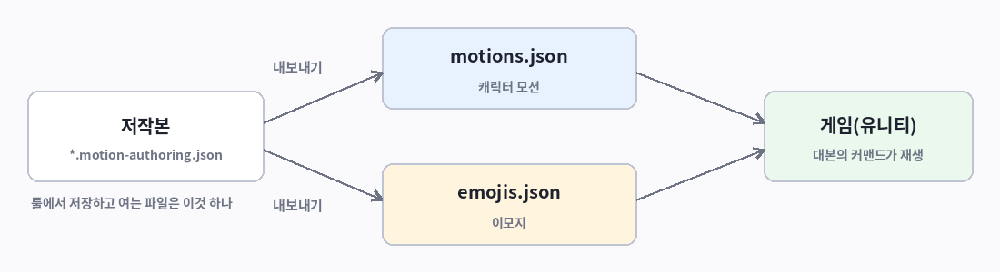

| 만드는 것 | 어디서 | 내보내면 |
|---|---|---|
| **캐릭터 모션** — 초상을 끄덕이고 숙이고 뛰게 한다 | 캐릭터 모션 모드 | `motions.json` |
| **이모지** — 인물의 머리 곁에 뜨는 그림 | 이모지 모드 | `emojis.json` |
| **연출 클립** — 모션 여럿을 겹쳐 보고 구워서 모션 하나로 | 캐릭터 모션 모드 | (구운 모션이 `motions.json`으로) |

툴에서 저장하고 여는 파일은 **저작본**(`*.motion-authoring.json`) 하나다.

실행: 저장소에서 `dotnet run --project src/Mt.App/Mt.App.csproj`. 처음 열면 캐릭터 하나가 선 빈 문서가 뜬다 — 따로 준비할 파일은 없다.

---

## 2. 캐릭터 모션

### 2-1. 화면

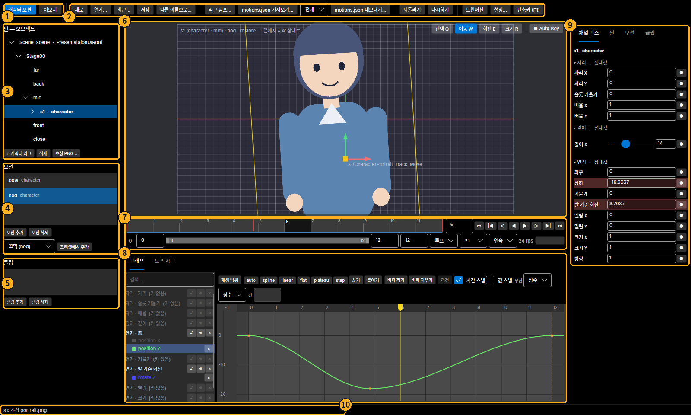

| | 이름 | 하는 일 |
|---|---|---|
| ① | **작업 모드** | 캐릭터 모션 / 이모지. 고른 일에 쓰는 것만 화면에 남는다 |
| ② | **툴바** | 새로 · 열기 · 저장 · 리그 덤프 · `motions.json` 가져오기 · 내보내기 범위 · 내보내기 · 되돌리기 · 트윈머신 · 설정 · 단축키(F1) |
| ③ | **씬 — 하이어아키** | 무대에 선 캐릭터와 그 **컨트롤러**(손잡이). 아래에 `+ 캐릭터 리그` · `초상 PNG…` |
| ④ | **모션** | 모션 목록 · 모션 추가 · 프리셋에서 추가 |
| ⑤ | **클립** | 모션을 겹쳐 보는 클립의 목록([3장](#3-모션-겹치기와-굽기)) |
| ⑥ | **뷰포트** | 캐릭터와 손잡이. 오른쪽 위가 도구(선택 · 이동 · 회전 · 크기)와 Auto Key |
| ⑦ | **타임 슬라이더** | 지금 프레임 · 재생 단추 · 재생 범위 · 길이 |
| ⑧ | **그래프 / 도프 시트** | 키와 곡선 |
| ⑨ | **채널 박스**(탭: 씬 · 모션 · 클립) | 고른 손잡이의 값. 값을 넣으면 키가 된다 |
| ⑩ | **상태 줄 · 문제 칸** | 방금 한 일, 내보내기를 막는 문제 |

### 2-2. 있는 것으로 시작하기 — 프리셋

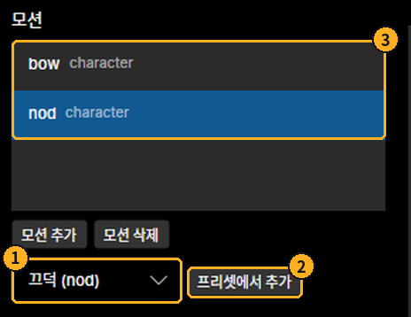

1. ① 콤보에서 움직임을 고른다(끄덕 · 젓기 · 깡충 · 움찔 · 떨림 · 숙임 · 바운스 · 호흡 · 돌아서기).
2. ② **프리셋에서 추가**를 누른다.
3. ③ 모션이 목록에 생기고 골라진다. **Alt+`**로 처음부터 재생해 본다(**Alt+Q** = 재생 / 멈춤).

처음부터 만들려면 **모션 추가** — 이름 `motion`, 길이 1초로 생긴다. 이름 · 길이 · 종료 처리는 오른쪽 **모션** 탭에서 바꾼다.

### 2-3. 키 놓기 — 손잡이를 잡고, 프레임을 옮기고, 값을 준다

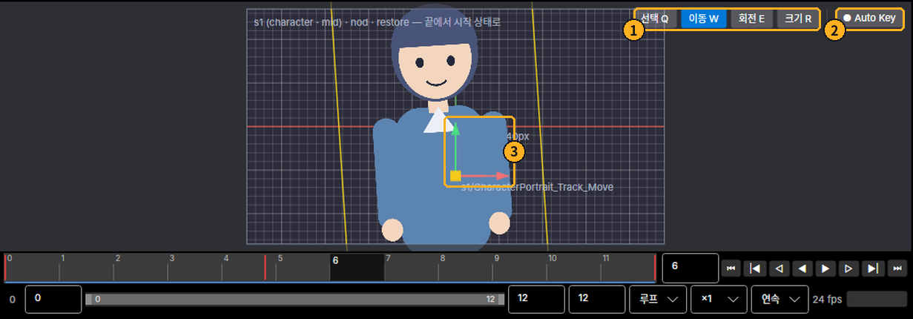

1. ① 도구를 고른다 — **이동 W · 회전 E · 크기 R**(선택 Q). 캐릭터에 ③ 손잡이가 선다.
2. ② **● Auto Key**를 켠다.
3. 타임 슬라이더에서 프레임을 옮긴다(클릭 · 끌기).
4. ③ 손잡이를 끈다 — 화살표 끝은 한 축만, 가운데 네모는 자유롭게. 놓는 순간 **그 프레임에 키**가 생긴다.

Auto Key가 **꺼져** 있으면 끈 결과가 주황색 "키 없는 포즈"로 남는다 — **S**로 키를 놓고 **Esc**로 버린다.

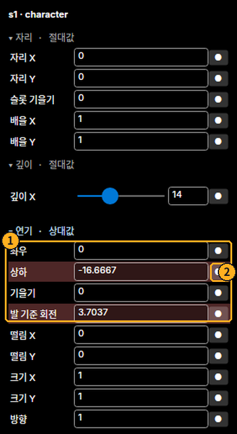

- ① **연기**의 손잡이(좌우 · 상하 · 기울기 · 발 기준 회전 · 떨림 · 크기 · 방향)가 모션의 본거지다. 캐릭터가 어디에 서 있든 같은 움직임이 난다.
- 값 칸에 숫자를 넣고 **Enter**를 눌러도 키가 된다. ② 오른쪽의 **●**는 그 값만 지금 프레임에 키로 놓는다.
- 칸의 색: **빨강** = 이 프레임에 키가 있다 · 연한 빨강 = 다른 프레임에 키가 있다 · 주황 = 키 없는 포즈.

### 2-4. 그래프에서 다듬기

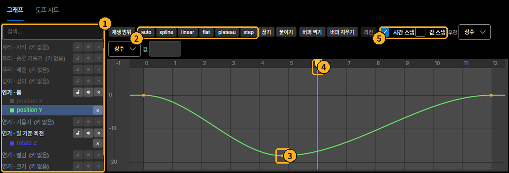

| | |
|---|---|
| ① | **채널 목록** — 손잡이 › 성분. 이름을 누르면 그 곡선만 보인다. 흐린 줄은 아직 키가 없는 것 |
| ② | **탄젠트** — 고른 키를 곡선이 어떻게 지나는가. `flat`(멈췄다 간다)이 가장 무난하다 · `auto` 부드럽게 · `linear` 직선 |
| ③ | **키** — 클릭으로 고르고, **가운데 단추(MMB)로 끌어** 옮긴다(시간 · 값). 빈 데서 끌면 상자로 여럿을 고른다 |
| ④ | **지금 프레임** — 눈금자를 끌어 옮긴다 |
| ⑤ | **스냅** — 시간을 프레임에, 값을 정수에 붙인다 |

- 키 끼우기: 곡선을 고르고 **I**(또는 더블클릭).
- 보기: 휠 = 확대 · **RMB 끌기** = 이동 · **A** = 전체 맞춤 · **F** = 고른 것 맞춤.
- 복사 · 붙여넣기 · 지우기: **Ctrl+C / V** · **Delete**. 되돌리기 **Ctrl+Z**.

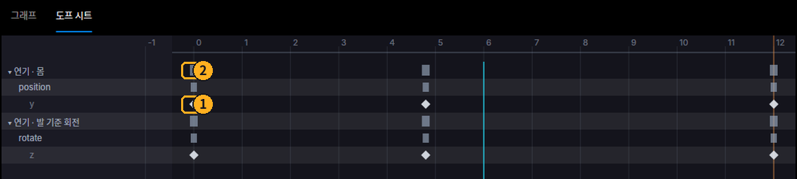

**도프 시트** 탭은 키를 시간으로만 다룬다. ① 키 하나, ② 그 손잡이의 키 전부(요약). 끌면 시간만 옮겨지고, **Alt+끌기**는 복제다.

### 2-5. 복원과 유지

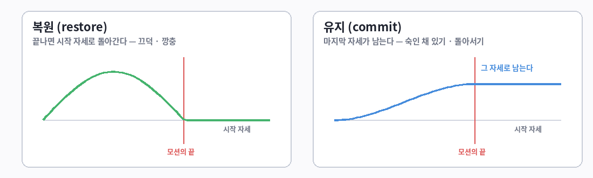

오른쪽 **모션** 탭의 **종료 처리**다. 복원인데 마지막 키가 0이 아니면 끝에서 튄다 — 문제 칸이 알린다.

### 2-6. 사이 포즈 — 트윈머신

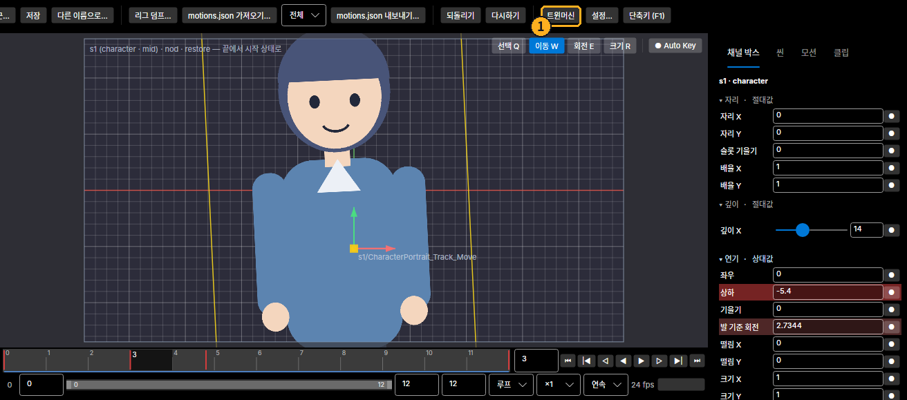

툴바의 ① **트윈머신**이 작은 창을 띄운다. 창은 떠 있는 채로 두고 본 화면을 그대로 만진다.

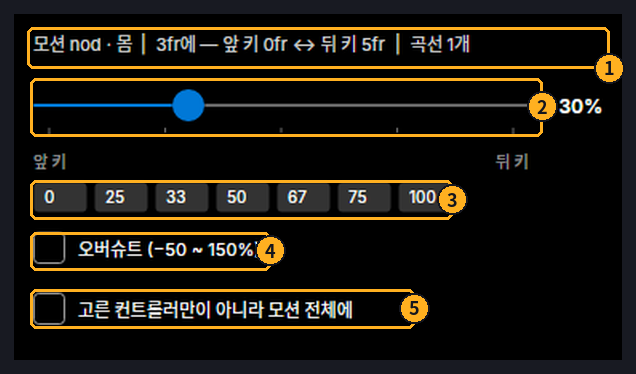

1. 손잡이를 고르고 **두 키 사이의 프레임**으로 간다. ① 첫 줄이 무엇에, 어느 키와 어느 키 사이에 놓이는지 적는다.
2. ② 슬라이더를 끈다 — 0%는 앞 키, 100%는 뒤 키의 값. 끄는 동안 화면이 따라오고 놓으면 키가 된다(되돌리기 한 칸).
3. ③ 단추는 누르면 바로 그 비율로 놓인다.
4. ④ **오버슈트** — −50 ~ 150%. 뒤 키를 지나치거나(100% 위) 반대로 먼저 가는(0% 아래) 포즈.
5. ⑤ 고른 손잡이만이 아니라 포즈 전체에 놓으려면 켠다.

### 2-7. 씬 — 캐릭터를 세우는 자리

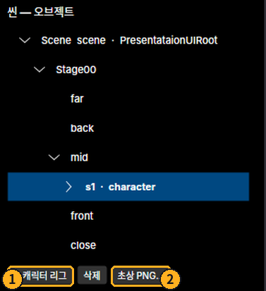

- ① **+ 캐릭터 리그** — 캐릭터를 더한다(`s1` · `s2` …).
- ② **초상 PNG…** — 고른 캐릭터의 그림을 넣는다. 없으면 자리표시 사각형으로 보인다.
- `s1 · character`를 펼치면 손잡이가 묶음별로 나온다 — 눌러서 고른다.

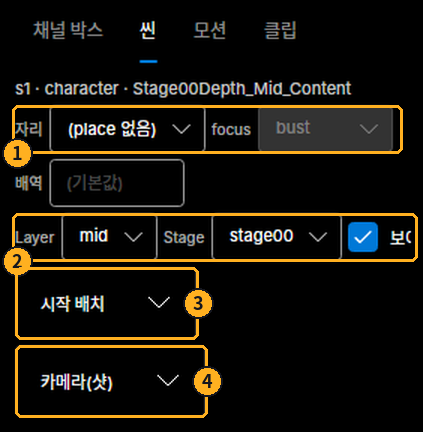

오른쪽 **씬** 탭은 고른 캐릭터를 **어디에 세워 놓고 볼지**다. 모션의 키가 아니고, 내보내지지도 않는다.

| | |
|---|---|
| ① | **자리 × focus** — 화면의 어느 지점(가운데 · 왼쪽 · 오른쪽 …)에 세울지 |
| ② | **Layer · Stage · 보이기** — 깊이 층 · 무대 · 숨기기 |
| ③ | **시작 배치** — 그 자리에서 조금 더 옮기고 돌리고 키운다 |
| ④ | **카메라(샷)** — 멈춘 zoom · pan. 구도만 잡는다(이 툴은 카메라를 움직이지 않는다) |

### 2-8. 내보내기

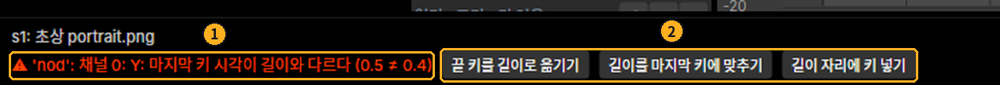

- 툴바의 **motions.json 내보내기…**. 그 왼쪽 콤보가 범위다(전체 / 이 리그만 / 이 캐릭터가 입는 모션만).
- 맨 아래에 ① 빨간 줄(⚠)이 있으면 **내보내지 못한다.** ② 옆의 단추가 한 번에 고쳐 준다.
- 노란 줄(△)은 알림이다 — 내보내진다.

---

## 3. 모션 겹치기와 굽기

숙이면서 끄덕이기처럼 **모션 둘을 한 캐릭터에 겹쳐** 보고, 마음에 들면 **구워서 모션 하나**로 만든다.

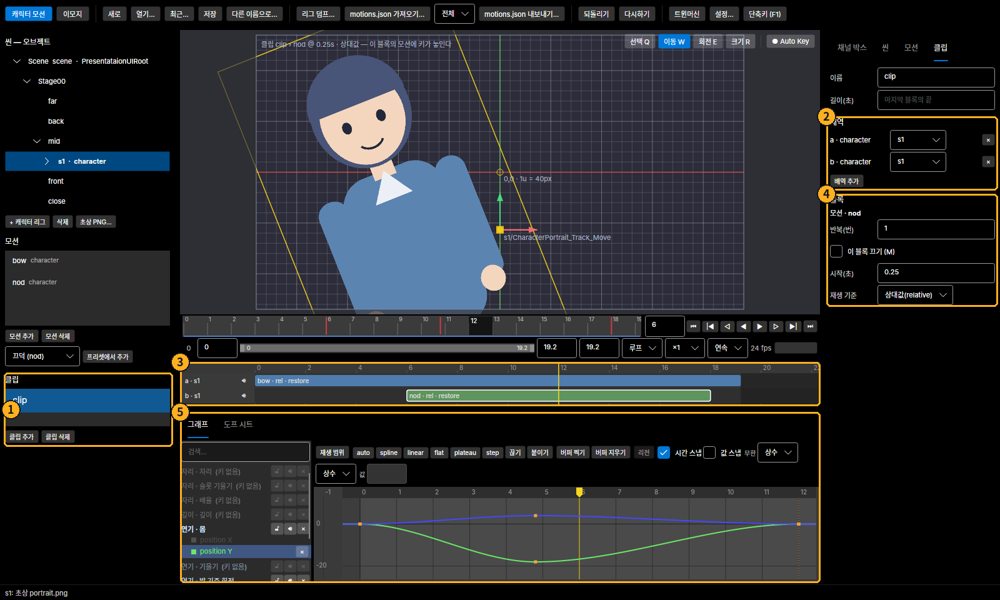

1. ① 왼쪽 **클립 추가**. 클립을 고르면 ③ 타임라인이 그래프 위에 선다.
2. 뷰포트에서 캐릭터를 고르고 오른쪽 **클립** 탭의 ② **배역 추가** — 줄이 하나 생긴다. 겹치려면 같은 캐릭터로 **한 번 더** 누른다(줄이 둘).
3. ③ 줄의 빈 곳을 **오른쪽 단추 → 모션 놓기**. 블록을 끌어 시각을 맞춘다.
4. 블록을 누르면 ④ 그 블록의 값(반복 · 끄기 · 시작 · 재생 기준)과 ⑤ 그 모션의 곡선이 나온다 — 여기서 바로 고친다.
5. 줄의 빈 곳을 **오른쪽 단추 → 새 모션으로 굽기**. `클립이름_캐릭터` 모션이 왼쪽 목록에 생긴다 — 이것을 내보낸다.

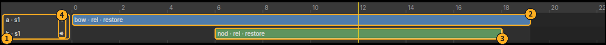

| | |
|---|---|
| ① | **줄 머리** — 배역과 맡은 캐릭터 |
| ② ③ | **블록** — 모션 하나. 끌어서 옮긴다. 더블클릭 = 그 모션만 열기 · **M** = 이 블록만 끄기 · **Ctrl+D** = 이어서 한 번 더 |
| ④ | **🔊** — 그 배역 전체를 끄고 켠다(보기만). 끈 배역은 굽지 않는다 |

- 같은 캐릭터의 **같은 손잡이**를 쓰는 블록은 시간이 겹칠 수 없다(빨간 테두리). 다른 손잡이를 쓰는 모션끼리 겹친다.
- 모션은 함께 쓰는 것이라 고치면 그 모션을 쓰는 블록이 다 바뀐다. 이 블록만 다르게 하려면 블록 오른쪽 단추 → **이 블록만 따로**.

---

## 4. 이모지

### 4-1. 이모지는 이렇게 생겼다

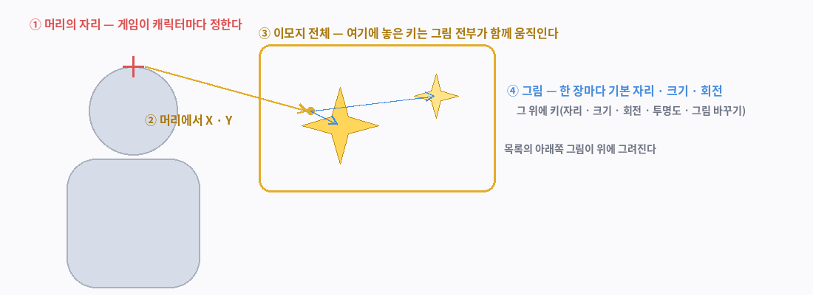

이모지는 **그림 여러 장이 타임라인 하나**(초당 24프레임)를 함께 쓴다. ① 머리의 자리는 게임이 정하고, 툴에서는 ② 거기서 얼마나 떨어져 뜨는지와 ③ ④의 움직임을 만든다.

### 4-2. 화면

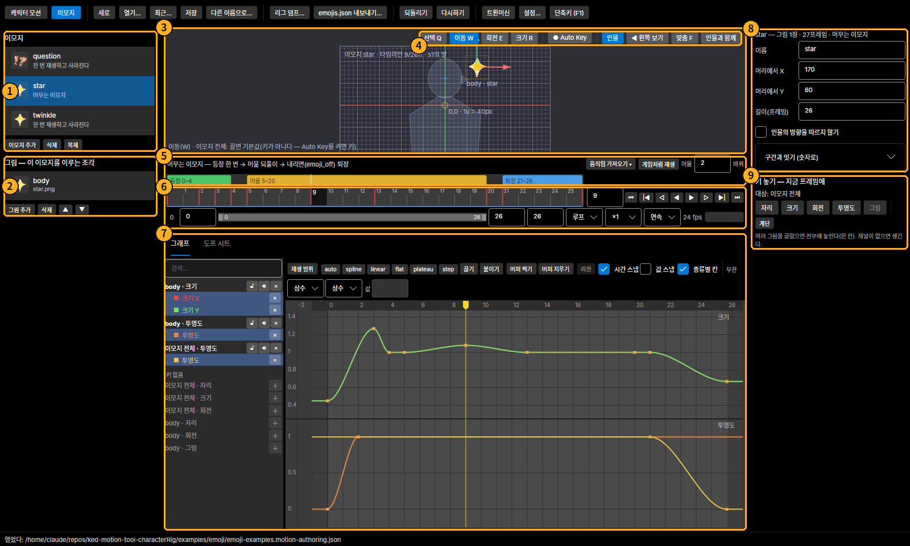

| | 이름 | 하는 일 |
|---|---|---|
| ① | **이모지 목록** | 누르면 그 **이모지 전체**가 대상이 된다. 아래에 이모지 추가 · 삭제 · 복제 |
| ② | **그림 목록** | 이 이모지를 이루는 그림. 누르면 그 **그림**이 대상이 된다. ▲ ▼ = 그리는 순서 |
| ③ | **뷰포트** | 인물의 머리에 선 이모지 |
| ④ | **도구 띠** | 선택 · 이동 · 회전 · 크기 · Auto Key / 인물 · 왼쪽 보기 · 맞춤 · 인물과 함께 |
| ⑤ | **수명의 띠** | 등장 · 머묾 · 퇴장 |
| ⑥ | **타임 슬라이더** | 지금 프레임 · 재생 |
| ⑦ | **그래프** | 종류마다 한 칸(크기 · 투명도 …) |
| ⑧ | **고른 것의 값** | 이모지를 골랐으면 이름 · 머리에서 X · Y · 길이 / 그림을 골랐으면 그림 파일 · 자리 · 크기 · 회전 |
| ⑨ | **키 놓기** | 자리 · 크기 · 회전 · 투명도 · 그림 |

**무엇을 골랐는가가 전부를 정한다** — 오른쪽의 칸, 그래프에 보이는 곡선, 끌 때 움직이는 것, 키가 놓이는 곳.

### 4-3. 새 이모지

왼쪽 **이모지 추가**를 누르면 이 창이 뜬다.

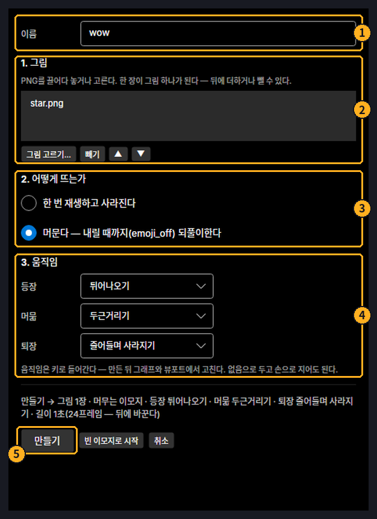

1. ① **이름** — 영문 소문자 · 숫자 · `_`. 대본이 이 이름으로 부른다.
2. ② **그림** — PNG를 창에 끌어다 놓거나 **그림 고르기…**. 한 장이 그림 하나가 된다. ▲ ▼로 순서를 바꾼다(아래가 위에 그려진다).
3. ③ **어떻게 뜨는가** — 한 번 재생하고 사라진다 / 머문다.
4. ④ **움직임** — 등장 · 머묾 · 퇴장을 고른다(없음도 된다).
5. ⑤ **만들기**.

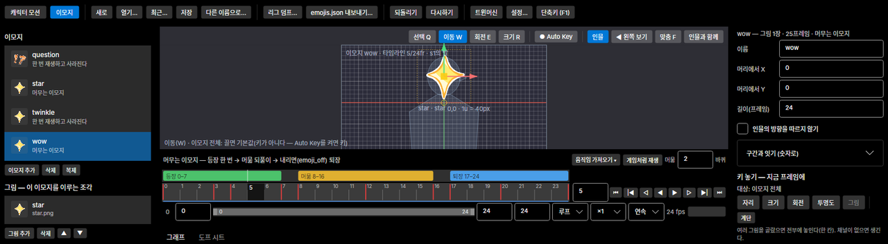

움직이는 이모지가 바로 생긴다. **▶**로 재생해 본다.

### 4-4. 수명 — 등장 · 머묾 · 퇴장

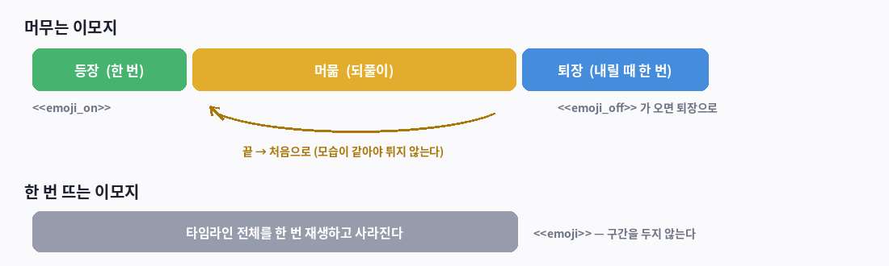

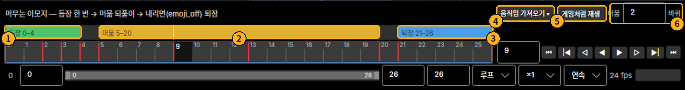

| | |
|---|---|
| ① ② ③ | **등장 · 머묾 · 퇴장**의 띠. **끝을 끌면** 길이가, **몸통을 끌면** 자리가 바뀐다. 오른쪽 단추 = 풀기 · 지우기. 없는 자리는 `+ 등장` 같은 단추로 놓는다 |
| ④ | **움직임 가져오기 ▾** — 미리 만든 움직임의 키를 넣는다 |
| ⑤ | **게임처럼 재생** — 등장 → 머묾 → 퇴장을 게임과 같은 계산으로 돌려 본다 |
| ⑥ | 머묾을 몇 바퀴 돈 뒤 내릴지 |

머묾은 되풀이되니 **머묾의 처음과 끝의 모습이 같아야** 튀지 않는다.

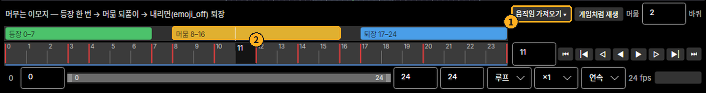

① **움직임 가져오기 ▾**에서 고르면 ② 그 자리의 구간에 키가 들어간다 — 등장(튀어나오기 · 서서히 나타나기) · 머묾(두근거리기 · 흔들기) · 퇴장(위로 사라지기 · 줄어들며 사라지기). 대상은 고른 그림이고, 안 골랐으면 이모지 전체다. 넣은 것은 그냥 키라 마음대로 고친다.

### 4-5. 뷰포트에서 만지기

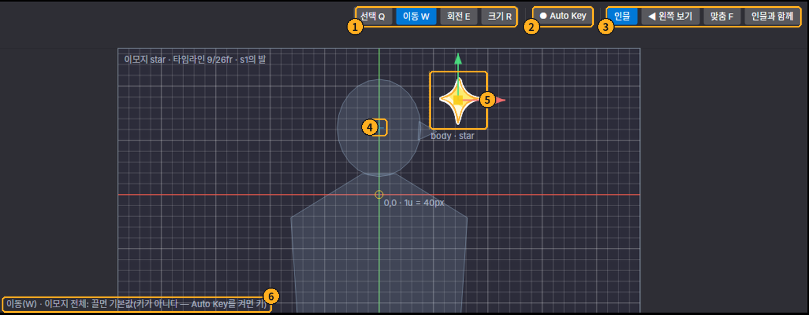

| | |
|---|---|
| ① | 도구 — 선택 Q · 이동 W · 회전 E · 크기 R |
| ② | **Auto Key** — 꺼짐: 끌면 **기본값**(그 그림을 어디에 얼마만 하게 두는가)이 바뀐다 / 켜짐: 끌면 **지금 프레임에 키** |
| ③ | 보기 — 인물 보이기 · 왼쪽 보기 · 그림에 맞춤 · 인물과 함께 |
| ④ | **머리의 자리**(십자) |
| ⑤ | 그림과 손잡이 — 눌러서 고르고 끈다 |
| ⑥ | **지금 끌면 무엇이 바뀌는지**를 적는 글 — 헷갈리면 여기를 본다 |

- **이모지 전체**를 옮기려면 왼쪽 목록에서 이모지를 누르고 끈다. **그림 하나**는 뷰포트에서 그 그림을 누른다.
- 빈 데를 누르면 선택이 풀린다 — 고른 것이 없으면 끌어도 움직이지 않는다.
- 여럿 고르기: **Shift**로 더하거나 빈 데서 끌어 상자로. 여럿을 고르고 **회전(E)**하면 가운데를 축으로 무리 전체가 돈다.

### 4-6. 키와 그래프

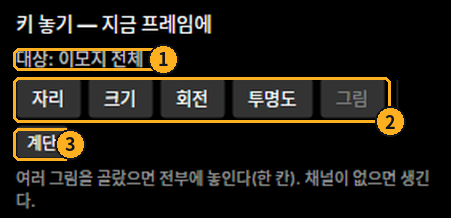

① 대상(고른 그림들, 없으면 이모지 전체)에 ② 그 종류의 지금 값을 지금 프레임의 키로 놓는다. **투명도**와 **그림**(그림 바꾸기)은 뷰포트에서 끌 수 없으니 여기서 키를 놓고 그래프에서 값을 바꾼다. ③ **계단**은 고른 키를 "다음 키까지 그 값으로 멈춤"으로 만든다.

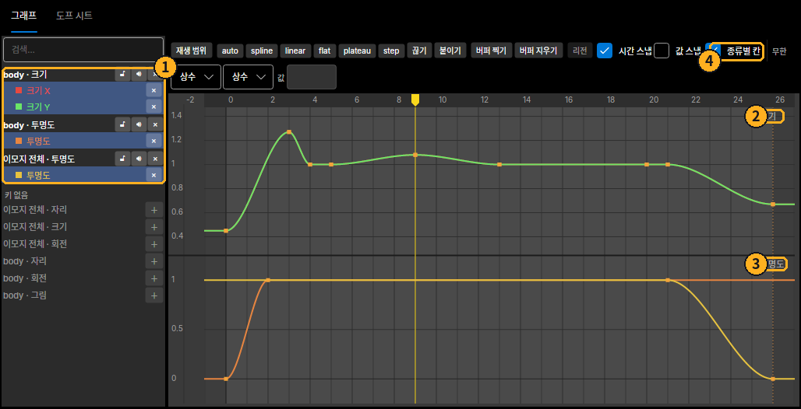

① 목록에서 곡선을 고른다(아래 "키 없음" 줄의 **＋**는 그 채널에 키를 놓는다). 그래프는 ② 크기 ③ 투명도처럼 **종류마다 제 눈금의 칸**에 그린다 — ④ **종류별 칸**을 끄면 한 눈금에 그린다.

### 4-7. 좌우

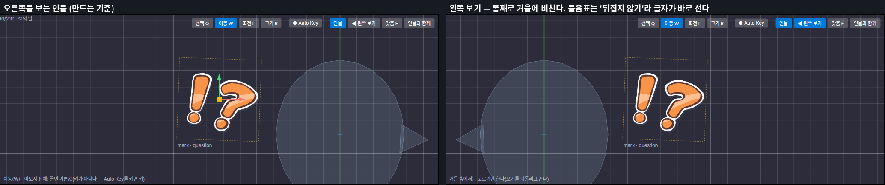

이모지는 **오른쪽을 보는 인물**을 기준으로 만든다. 인물이 왼쪽을 보면 게임이 통째로 거울에 비춘다 — 따로 만들지 않는다. 도구 띠의 **◀ 왼쪽 보기**로 확인한다.

- 글자 · 물음표처럼 뒤집히면 안 되는 그림: 그 그림의 **"인물이 돌아서도 이 그림은 뒤집지 않기"**.
- 머리 위 한가운데에 뜨는 것처럼 방향과 상관없는 이모지: 이모지의 **"인물의 방향을 따르지 않기"**.

### 4-8. 내보내기

툴바의 **emojis.json 내보내기…**. 막는 문제가 있으면 맨 아래에 `이모지 …`로 나오고 쓰지 않는다. 그림 파일은 저작본과 같이 옮긴다 — 게임은 그림을 **파일 이름**으로 찾는다.

---

## 5. 자주 쓰는 키

| 키 | 뜻 |
|---|---|
| **Alt+`** · **Alt+Q** | 처음부터 재생 · 재생 / 멈춤 |
| **Q / W / E / R** | 선택 · 이동 · 회전 · 크기 |
| **S** · **Esc** | 키 놓기 · 키 없는 포즈 버리기 |
| **1 / 2** · **← / →** | 이전 · 다음 키 · 한 프레임 |
| **Ctrl+S** · **Ctrl+O** · **Ctrl+N** | 저장 · 열기 · 새로. 창 제목의 **•**는 "저장하지 않은 것이 있다" — 그 채로 닫으면 먼저 묻는다 |
| **Ctrl+Z / Ctrl+Y** | 되돌리기 · 다시하기(조작 하나가 한 칸) |
| **I** | (그래프) 고른 곡선에 키 끼우기 |
| **MMB 끌기** | (그래프) 고른 키 옮기기 |
| **A** · **F** | 전체 맞춤 · 맞춤 |
| **M** | (타임라인) 블록 끄기 |
| **F1** | 단축키 전체 |

막혔을 때는 [`../USER-GUIDE.md` §18](../USER-GUIDE.md#18-막혔을-때).

---

이 문서의 그림은 툴이 그린 실제 화면이다. 다시 만드는 법:

```bash
MT_RENDER_DIR=<화면 폴더> dotnet test tests/Mt.App.Tests -c Release --filter Shots
python3 tools/guide-figures.py <화면 폴더> docs/guide/img
```
